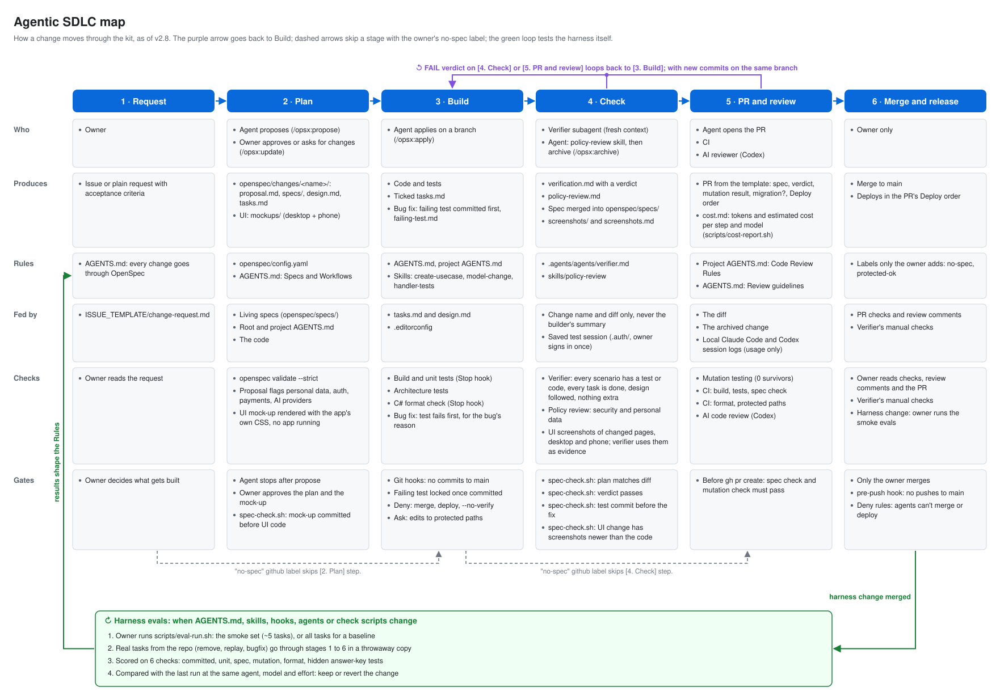

# agentic-dotnet-sdlc

A starter kit for running an **agentic software development lifecycle** in a .NET repository: coding agents (Codex, Claude Code) work on branches and open pull requests, checks run at every step, an AI reviewer comments, and a human merges.

Everything here has been used on a real production .NET SaaS before being added. The kit grows one tested step at a time.

## The loop

```
Request → agent proposes a spec (and a UI mock-up) → you approve → agent builds on a branch → checks (hooks, tests, mutation, format, screenshots) → a second agent verifies against the spec → PR → CI → AI review → you merge

Two ways to run it: drive the agent on your machine, step by step; or label the issue agent:plan → the agent opens a plan PR → you merge it to approve → it builds and opens the PR → review comments start fix runs → you merge

When the harness itself changes: you run the harness evals → the same real tasks go through the loop above → compare with the last run → keep or revert
```

The short version:


See the **[SDLC map](docs/sdlc-map.md)** for every stage in detail: who does the work, what it produces, which rules and files drive it, and what enforces it.

[](docs/sdlc-map.md)

## What's in it

### v0: the loop

| Path | What it is |
|------|------------|
| `templates/AGENTS.md` | Root instructions for every coding agent: code style, build/test/verify, mutation check, git workflow, migrations |
| `templates/project-AGENTS.md` | Per-project conventions, architecture tests and **Code Review Rules** for the AI reviewer |
| `templates/CLAUDE.md` | `@AGENTS.md`, so Claude Code reads the same instructions as Codex, plus Claude hook notes |
| `templates/.github/ISSUE_TEMPLATE/change-request.md` | Issue template for requirements with acceptance criteria |
| `templates/.github/pull_request_template.md` | PR template: what changed, which agent made it, verification, mutation check, migration needed? |
| `docs/codex-review.md` | Setting up automatic Codex review on GitHub, and what to do when it doesn't respond |

### v1: rules that are checked, not just written

| Path | What it is |
|------|------------|
| `templates/.githooks/` | Block commits, merge commits and pushes to `main` |
| `templates/.github/workflows/ci.yml` | Build every deployable project and run the unit tests on every PR |
| `templates/.claude/` | Claude Code hooks: build and test before finishing; mutation check before `gh pr create` |
| `templates/tests/ArchitectureTests.cs` | Use cases don't import each other, every handler has tests, every endpoint requires auth |
| `templates/scripts/mutation-check.sh`, `templates/tests/stryker-config.json`, `templates/.config/dotnet-tools.json` | Stryker.NET on changed code only; 0 surviving mutants required before a PR |
| `docs/enforced-checks.md` | How the layers fit together, setup steps, and lessons learned |

### v2: spec-driven changes and skills

| Path | What it is |
|------|------------|
| `templates/AGENTS.md` ("Specs and Workflows") | Every change goes through [OpenSpec](https://github.com/Fission-AI/OpenSpec): propose, owner approval, apply, policy review, archive; `no-spec` for changes the owner exempts |
| `templates/openspec/config.yaml` | Project context and rules OpenSpec adds to every proposal, design and task list |
| `templates/.agents/skills/` | Skills for Codex and Claude Code: `policy-review` (security and personal data), `create-usecase`, `model-change`, `handler-tests` |
| `templates/.claude/skills/` | Symlinks to the same skills, so Claude Code reads them too |
| `templates/scripts/spec-check.sh`, `templates/.claude/hooks/spec-check-before-pr.sh`, `templates/.github/workflows/spec-check.yml` | Spec check: code changes need an OpenSpec change, and every changed file must be named in its plan |
| `docs/spec-driven.md` | Setup, how a change goes through, how the spec check works, and lessons learned |
| `docs/examples/add-order-note/` | A complete worked change: proposal, spec, design, tasks and policy review |

### v2.5: stronger verification and guards

| Path | What it is |
|------|------------|
| `templates/.agents/agents/verifier.md`, `templates/.claude/agents/`, `templates/.codex/agents/` | A **verifier agent** with a fresh context checks the change against its spec, tasks and design and writes `verification.md`; the spec check needs a passing verdict |
| `templates/AGENTS.md` ("Bug fixes"), `templates/.claude/hooks/protect-failing-test.sh` | **Failing-test-first bug fixes:** the reproducing test is committed first and locked while the fix is made |
| `templates/scripts/ui-mockups.sh`, `templates/scripts/ui-mockup-template.html` | **UI mock-ups** drawn with the proposal, styled with the app's own CSS, desktop and phone |
| `templates/scripts/ui-screenshots.sh` | **UI screenshots** of the changed routes after the build, signed in through a session the owner saved once; agents never type credentials |
| `templates/scripts/spec-check.sh` | Now also checks the verifier verdict, the failing-test order and the UI mock-up and screenshot records |
| `templates/.editorconfig`, `templates/global.json`, `templates/scripts/format-check.sh` | **Format check** in the Stop hook and CI, with the SDK pinned |
| `templates/.claude/settings.json`, `templates/scripts/protected-paths.sh`, `templates/.github/workflows/protected-paths.yml` | **Guards:** deny rules for merging, workflows and hook bypasses; protected paths that need the owner's `protected-ok` label |
| `docs/verification.md` | Setup, how a change goes through now, why each piece is shaped this way, and lessons learned |

### v2.6: harness evals

| Path | What it is |
|------|------------|
| `templates/scripts/eval-run.sh`, `templates/scripts/eval_run.py` | **Eval runner:** gives real tasks from your repo to Claude Code or Codex in a history-free snapshot with no remote, through the normal flow, and scores six checks (committed on a branch, unit, spec, mutation, format, hidden answer-key tests); `--check` keeps tasks valid for free |
| `templates/evals/` | Task format (`tasks/README.md`) and the smoke set (`sets/smoke.txt`) run after every harness change |
| `templates/AGENTS.md` ("Evals") | When to run, who runs it (the owner), defaults for model and effort, and that agents never edit tasks or results |
| `docs/examples/evals/` | Three example tasks, one of each kind (remove, replay, bugfix) |
| `docs/evals.md` | Setup, how a run works, why it's shaped this way, Codex and Claude Code specifics, and lessons learned |

### v2.7: a model per step

| Path | What it is |
|------|------------|
| `templates/scripts/eval_run.py` | `--plan-model`, `--build-model`, `--verify-model`: run each step of the flow on its own model; a usage limit or API outage stops the run without scoring it, and `--run-id` continues it |
| `templates/scripts/eval-configs.sh` | Runs several plan/build/verify configurations in turn and waits out usage limits |
| `docs/model-per-step.md` | How to set a model per step, how to measure your own, and the measured results: Sonnet for every step won |

### v2.8: what each change cost

| Path | What it is |
|------|------------|
| `templates/scripts/cost-report.sh`, `templates/scripts/cost_report.py`, `templates/scripts/model-prices.json` | **Cost report:** tokens and estimated cost per step (plan, build, verify, policy review, archive, PR and review) and model for one change, from the local Claude Code and Codex logs; writes `cost.md` and the PR's Cost table |
| `templates/scripts/tests/test_cost_report.py` | Tests for it, with made-up logs |
| `templates/AGENTS.md` ("Cost report"), `templates/.github/pull_request_template.md` | Run it after archive and paste the table into the new Cost section; PR screenshots are now linked by commit SHA, so they keep working after the branch is deleted |
| `docs/cost-report.md` | How it works, what it can't see, setup, and lessons from building it |

### v3: agent runs from issues

| Path | What it is |
|------|------------|
| `templates/.github/workflows/agent-plan.yml`, `templates/.github/workflows/agent-build.yml` | **Label an issue `agent:plan`** and Claude Code runs the flow in GitHub Actions: a plan PR you review and merge, then the build, the PR into `main`, and fix runs from review comments and Codex findings. Working on your machine is unchanged |
| `templates/.github/agent-prompts/` | What each run is told: shared rules, plan, revise, build, fix (with triage rules for Codex findings) |
| `templates/scripts/agent_gate.py`, `templates/scripts/tests/test_agent_gate.py` | Who can start what, by GitHub login: agent users label and approve, write access starts fixes, Codex only with findings and within a round cap |
| `templates/scripts/cost_report.py` | CI runs record their own usage (`ci-usage.jsonl`), shown as "Claude Code (CI)" rows |
| `templates/scripts/protected-paths.sh` | New or changed NuGet packages need the owner's `protected-ok` |
| `templates/docs/threat-model.md`, `templates/.agents/skills/policy-review/` | A threat model for agents in your repo; the policy review checks harness changes against it |
| `docs/agent-runs.md` | How a change goes through, setup (secrets, Claude app, label, Codex token), why it's shaped this way, measured costs and lessons learned |

## Using it today

1. Copy `templates/` into the root of your repository (put `tests/` files into your unit test project).
2. Replace the `<placeholders>` with your project names and commands, and **run every build, test and check** to make sure it works.
3. Copy `project-AGENTS.md` into each project folder as `AGENTS.md`, with a `CLAUDE.md` next to it.
4. Set up the AI reviewer (`docs/codex-review.md`), the checks (`docs/enforced-checks.md`), OpenSpec (`docs/spec-driven.md`), verification and guards (`docs/verification.md`), harness evals (`docs/evals.md`), models per step (`docs/model-per-step.md`), the cost report (`docs/cost-report.md`) and, if you want agents to work from labelled issues, agent runs (`docs/agent-runs.md`).
5. Put the setup itself through the loop as your first PR.

## Roadmap

- Auto-merge for low-risk PRs, once written risk rules and a track record exist
- Install with an agent skill instead of copying files, a reusable CI workflow, and a NuGet package for the architecture checks

## License

MIT
