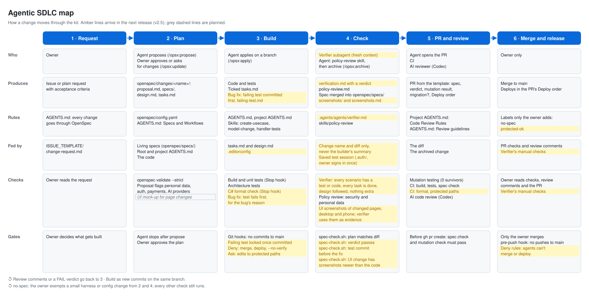

# The agentic SDLC map

How a change moves through this kit, one column per stage. Every stage has the same six rows:

- **Who** does the work.
- **Produces:** the files or artifacts that come out.
- **Rules:** the instructions the agent follows at this stage.
- **Fed by:** the context those rules draw on.
- **Checks:** what is actually verified at this stage, by tools or agents: tests, mutation testing, the verifier, policy review, AI code review.
- **Gates:** what stops a change from moving on: approvals, hooks, deny rules, scripts that must pass.



Amber lines are in use on the source project and come to the kit in the next release. Grey dashed lines are planned and not built yet.

## Escape hatches

- **`no-spec`:** the owner exempts a small harness or config change from Plan and Check. Every other check still runs.
- **`protected-ok`** (next release): the owner approves a change to CI, hooks, agent settings, scripts or migrations.
- Agents never add either label.

## Keeping it up to date

The map is drawn from [`sdlc-map.json`](sdlc-map.json). To change it, edit the JSON, then regenerate the SVG:

```bash
python3 tools/render-sdlc-map.py
```

- Start a line with `+` to mark it as arriving in the next release (drawn in amber).
- Start a line with `~` to mark it as planned (grey, dashed). Change it to `+` once it works on the source project.
- When a release ships, remove the `+` from its lines and add a row to the changelog below.
- Commit the JSON and the SVG together.

## Changelog

| Release | What the map gained |
|---------|---------------------|
| v0 | Request, build on a branch, PR, AI review, owner merges |
| v1 | Git hooks, Stop hook, architecture tests, mutation check, CI |
| v2 | Plan stage (OpenSpec), skills, policy review, spec check, Deploy section in the PR |
| v2.5 (next) | Verifier and the Check stage's verdict, failing-test-first bug fixes, deny rules, protected paths, format check, UI screenshots |
